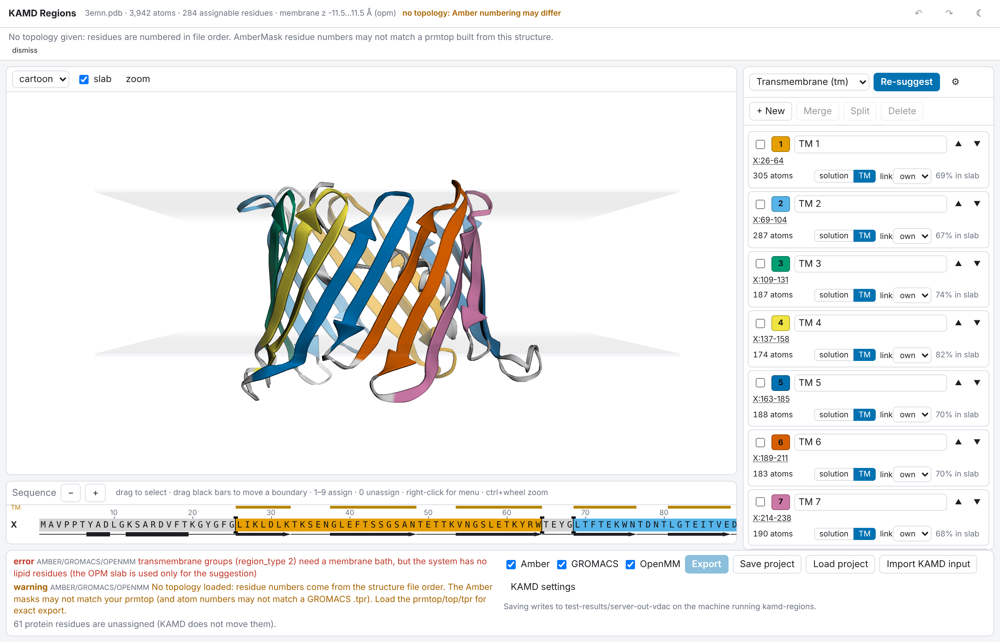
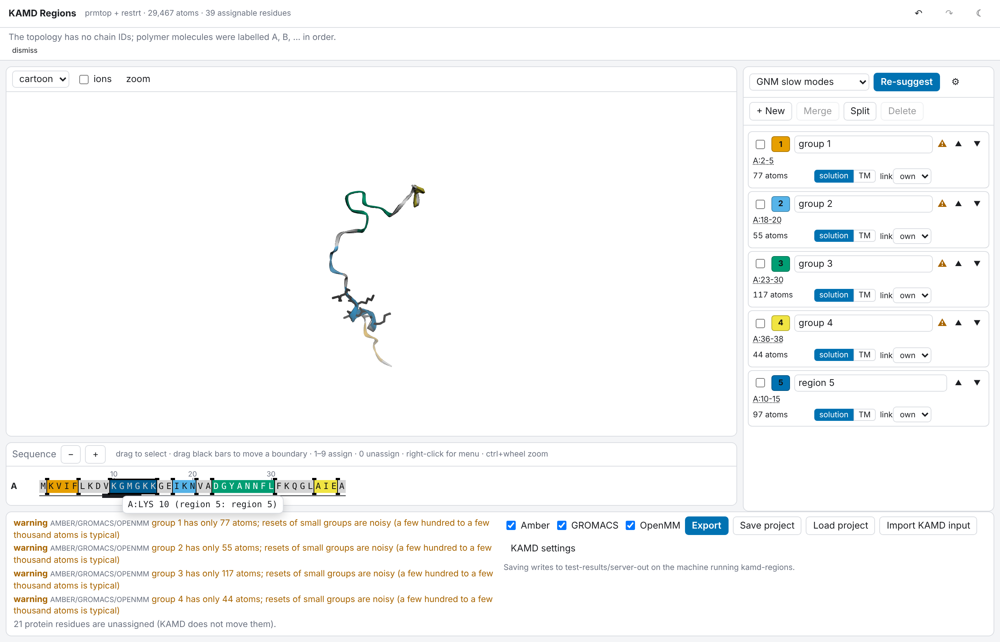
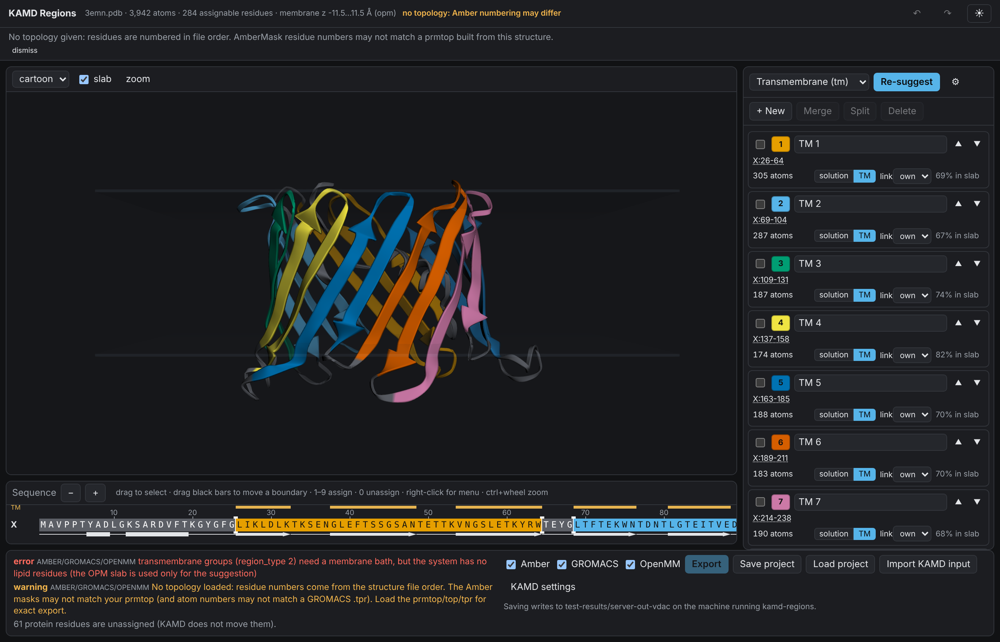

# kamd-regions — choose KAMD reference groups

The hardest part of a KAMD input is the **reference groups**: the structural units (domains,
motifs, transmembrane helices or β-strands) that should move relative to each other in the
transition you want to sample. Writing them by hand as AmberMasks or index groups is error-prone.
`kamd-regions` does three things:

1. **suggests** a set of groups for a protein or membrane-protein system;
2. **shows** them colour-coded in a 3D view and a PyMOL-style sequence bar;
3. lets you **edit** them per residue and **export** ready-to-use KAMD inputs for
   Amber (`&kamd`), GROMACS (`index.ndx` + `kamd.dat`) and OpenMM (`KAMDConfig`).



| | |
|---|---|
|  |  |
| Amber test system: the four imported `&kamd` groups plus a new region 5 drawn on the sequence bar | Dark theme |

## Install

Python ≥ 3.10. The GUI is pre-built and ships inside the package; Node is not needed.

```bash
pip install --no-deps ./openmm          # kamd_openmm, used to re-validate exports (numpy only)
pip install ./tools/kamd-regions        # add [gromacs] for .tpr/.top input (MDAnalysis)
```

## Start

```bash
kamd-regions serve system.prmtop system.rst7
```

This loads the system, runs an automatic suggestion, starts a local server on
`http://127.0.0.1:8765/` and opens the browser. More examples:

```bash
kamd-regions serve protein.pdb                              # view/edit only; numbering warning on export
kamd-regions serve step5_input.pdb                          # CHARMM-GUI membrane system (PDB is enough to view)
kamd-regions serve amber/test/prmtop amber/test/restrt amber/test/md_test.in   # import an existing &kamd
kamd-regions serve topol.tpr conf.gro kamd.dat index.ndx    # import a GROMACS KAMD input
kamd-regions serve system.prmtop system.rst7 project.json   # continue a saved project
```

Without the GUI (scripts, tests):

```bash
kamd-regions suggest system.prmtop system.rst7 --method gnm --out project.json --export-dir kamd_inputs
kamd-regions validate system.prmtop system.rst7 project.json
kamd-regions export   system.prmtop system.rst7 project.json --out-dir kamd_inputs
kamd-regions compare  system.prmtop system.rst7 md.in --methods gnm,contacts --out report.md
```

`--param key=value` passes method parameters (e.g. `--param n_regions=3 --param min_heavy=200`).

### Inputs

| file | role |
|---|---|
| PDB / mmCIF / gro | structure; may be the whole solvated (and membrane) system |
| prmtop (+ inpcrd/rst7/restrt/pdb), top or tpr (+ gro) | **topology** — needed for exact Amber/GROMACS numbering |
| `&kamd` mdin, `kamd.dat` + `index.ndx`, `kamd_openmm.json` | existing KAMD input, imported for editing |
| `project.json` | a saved kamd-regions project |
| AlphaFold PAE JSON, second conformation | accepted, not used yet (roadmap) |

## Using the GUI

* **3D view** (3Dmol.js): cartoon coloured by region, unassigned residues light grey;
  switch to surface or sticks. Membrane systems open side-on with the slab drawn as two
  translucent planes; lipids, water and ions are hidden (lipids and ions can be toggled).
  Click a residue to select it, shift+click selects a range, ctrl+click adds. Hovering shows
  `chain:resname resid (region N)`.
* **Sequence bar**: one row per chain, one-letter code, a number every 10 residues, the region
  colour as the cell background, a secondary-structure strip (bar = helix, arrow = strand,
  line = coil) and a TM marker above transmembrane segments.
  * drag to select a stretch; then press **1–9** (region N; the next free number creates a new
    region), **0** / Delete to unassign, **n** for a new region, or use the right-click menu;
  * the black bars between two regions (or a region and unassigned residues) are **boundary
    handles**: drag them left/right to grow one side and shrink the other;
  * ctrl+wheel or −/+ zooms, the bar scrolls horizontally for long chains.
  * Selections are linked with the 3D view in both directions.
* **Region panel**: colour (palette or free colour), name, residue summary (click to select),
  atom count, `region_type` (solution / TM), `refer_link` target, warning badge, and ▲▼ to set
  the group order (= KAMD group numbers). New / merge (tick ≥ 2) / split (moves the selected
  residues of one region into a new one) / delete. **Re-suggest** runs a method with editable
  parameters and asks before overwriting manual edits.
* **Undo / redo**: ctrl+z / ctrl+shift+z (or ctrl+y).
* **Validation** runs on every change. Export is disabled while there are errors for the selected
  engines. **KAMD settings** sets `pseudobd_cycles`, `nzero_crossings`, temperature, cutoffs,
  `kamd_shell_mode`, seed, and an optional manual membrane slab.
* **Export** shows the verification result and download links; **Save project** writes
  `project.json` to the output directory (default `./kamd_regions_out`, `--out-dir`) and downloads it.

## Automatic suggestion

Every method returns residue → region id (0 = unassigned) and goes through the same
post-processing.

| method | default | what it does |
|---|---|---|
| `gnm` | yes (no membrane) | Gaussian network model on the protein Cα atoms (cutoff 10 Å; nucleic acids are left out of the network). The Kirchhoff matrix is the Laplacian of the contact network; residues are clustered (k-means) on the k−1 slowest non-zero modes, i.e. the largest-scale relative motions, and k is chosen by the eigengap unless `n_regions` is set. Hinges (sign changes of the slowest mode) are reported. Needs one structure. Tested on ADK, T4 lysozyme and HhaI methyltransferase: [docs/gnm_multidomain.md](docs/gnm_multidomain.md). |
| `contacts` | | heavy-atom contact graph (4.5 Å, plus sequence-neighbour edges) split into communities with Leiden (`leidenalg`; RB-configuration, `resolution` slider, higher = smaller blocks). Gives spatially compact blocks. |
| `tm` | yes when a membrane and TM segments are found | DSSP helices (≥ 10 residues) and strands (≥ 5) that cross the slab: enough residues inside it **and** an extent along the normal ≥ 45 % of the slab thickness, which keeps amphipathic interface helices out. One group per segment or per `per_group` neighbouring segments (0 = as many as needed for `min_heavy_tm`); short turns between them are included. `region_type = 2`. Large extramembrane parts are decomposed with GNM into solution groups. |

Post-processing (all methods): runs shorter than `min_run` residues are smoothed into a
neighbour; coil termini and coil loops ≥ `loop_min_len` with high GNM fluctuation
(> `flex_factor` × median) are left unassigned — KAMD does not move unassigned protein atoms,
which is what you want for flexible linkers and tails; regions below `min_heavy` heavy atoms
(default 150, about 300 atoms with hydrogens; for very small proteins capped at a third of the protein) are merged into the
region they touch most; at most 32 regions (the Amber limit); ids renumbered in sequence order.
Ligands and other non-polymer residues can be assigned by hand but are never assigned
automatically.

ProDy is not a runtime dependency: the GNM is a few lines of numpy/scipy, and the tests check that
the eigenvalues agree with `prody.GNM`.

### Membrane and bath detection

* **Bath** by residue name: water (WAT, HOH, TIP3, SOL, …), ions (Na+, SOD, CLA, K+, …) and lipids
  — CHARMM36 names (POPC, POPE, CHL1, PSM, …) and Amber Lipid21/17/14 fragments (PA, OL, PC, PE, …).
  Lipid21 fragments are merged into whole molecules from the topology's bonds, or, for a plain PDB,
  by covalent distance between consecutive fragments.
* **Normal**: z is tried first and accepted if the lipid phosphorus atoms form two well separated
  layers; otherwise x and y are tried. The slab is the mean height of the two phosphate layers.
  Plain OPM PDB files (with `DUM` pseudo-atoms) give the hydrophobic slab directly.
* `solvent_mask` and `membrane_mask` are written as residue ranges and checked for contiguity
  (Amber needs one contiguous atom range each). A split bath is an error that names the residues
  in between and says how to reorder the system.

## Validation

Errors (block export for the engines concerned): fewer than 2 groups; more than 32 groups (Amber);
an empty group; transmembrane groups without lipids in the system or without a membrane axis;
non-contiguous bath (Amber); water/ions/lipids inside a group; bad or self `refer_link`.
Warnings: small (< 200 atoms) or large (> 15 000 atoms) groups — for structures without hydrogens
the count is estimated as 2 × heavy atoms; TM groups mostly outside the slab; solution groups buried
in the membrane; every group linked to one direction; chained links; missing topology.
Overlap cannot happen: a residue belongs to at most one region.

## Export

| engine | files |
|---|---|
| Amber | `kamd_amber.in`: `&kamd` with `refer_mask(i) = ":1-77,120-131"`, `solvent_mask`, and when needed `region_type(i)`, `refer_link(i)`, `membrane_mask`, `membrane_axis`, `membrane_cut`, `kamd_shell_mode = 2` (membrane systems). Comments give the chain/resid ranges. |
| GROMACS | `index.ndx` (one group per region + `KAMD_SOLVENT`, `KAMD_MEMBRANE`) and `kamd.dat` (cutoffs in nm) |
| OpenMM | `kamd_openmm.json` (0-based atom indices) and `kamd_openmm_example.py` that builds the `KAMDConfig` |
| all | `project.json` |

After export the files are re-read and checked: each Amber mask is evaluated with ParmEd's
`AmberMask` and compared atom by atom with the groups, the index file is parsed back, and the
groups go through `kamd_openmm.KAMDConfig(...).validate(n_atoms)`.

## Residue numbering (important)

* Internally every residue is identified by its **sequential index in the topology** (0-based).
* AmberMask `:N` is that index + 1 — the prmtop's sequential residue number. It is **not** the
  PDB resid and has no chains: `A:120` in the GUI may be `:245` in the mask.
* GROMACS index files and AmberMask `@N` use 1-based **atom** numbers; OpenMM uses 0-based atom indices.
* The GUI shows chain and PDB residue numbers (prmtop: molecules are labelled A, B, …), and
  converts on export.
* With only a PDB, viewing and editing work, but the numbering is the order of residues in that
  file. tleap/pdb2gmx/CHARMM-GUI can add, remove or reorder residues, so the exported masks carry a
  clear warning. Load the prmtop/top/tpr for an exact export.

## Tests

```bash
cd tools/kamd-regions && pytest -q                       # 66 tests
cd frontend && npm ci && npx playwright install chromium && npx playwright test   # end-to-end
```

* unit: mask compression/parsing round trips, numbering (PDB chains vs. sequential index vs. atom
  numbers), bath contiguity, Lipid21 molecule merging, membrane normal/slab on synthetic bilayers
  (CHARMM and Lipid21, normals x/y/z), method output shapes, GNM vs. ProDy, validation cases;
* integration on `amber/test` (prmtop + restrt + md_test.in): the imported four groups equal the
  original masks atom by atom; the export round-trips through ParmEd and equals
  `gromacs/validation/index.ndx`; `config_from_amber` gives the same groups;
* multi-domain: adenylate kinase (open) and T4 lysozyme recover their literature domains
  (ARI ≥ 0.6 / 0.55); full benchmark in [docs/gnm_multidomain.md](docs/gnm_multidomain.md);
* membrane: OPM VDAC1 (3emn) — the `tm` method finds all 19 β-strands; OmpA (1qjp);
* end-to-end (Playwright): load the test system, drag-select on the sequence bar, create a region,
  reassign via the context menu, drag a boundary, undo/redo, export and check `index.ndx`,
  re-suggest, membrane view. `SCREENSHOTS=1` regenerates the images in `docs/img/`.

The comparison of automatic and manual groups on the Amber test system is in
[docs/comparison_amber_test.md](docs/comparison_amber_test.md). In short: that protein is a
39-residue, mostly unstructured chain with four hand-picked 3–8-residue motifs; GNM and contacts
return two (or, when asked, three) contiguous halves that cover 65–100 % of manual groups 2–4, but
drop group 1 (the flexible N-terminus is left unassigned). It validates the numbering and export
path, not domain detection.

## Known limitations

* The automatic methods target domains of hundreds of atoms or more; on small or disordered
  proteins they give coarse halves (see the report). Always review the suggestion.
* `gnm`'s eigengap often picks only the largest motion (ADK: CORE vs. LID); set `n_regions` when
  you know how many domains to expect. In compact closed states domains can fuse (closed ADK).
* GROMACS `.top` files need their force-field includes; `.tpr` (MDAnalysis) is the safer input.
* Membrane detection expects a planar bilayer; vesicles, micelles and strongly curved membranes
  are not handled (set the slab manually in *KAMD settings*).
* Regions are whole residues; an imported mask that splits a residue is rounded (with a note).
* A plain OPM PDB has no lipids, so TM groups can be suggested but not exported until the
  membrane system is built.
* Large systems: the 3D view loads solute heavy atoms only; lipids are drawn as lines. Systems
  with ≫ 10⁵ lipid atoms make the lipid toggle slow.
* Headless WebGL (CI) renders with SwiftShader; the GUI itself is tested in Chromium only.

## Roadmap

PAE-based domains (AlphaFold; note that PAE often merges tightly packed lobes such as the two
kinase lobes), DynDom-style rigid-body analysis from two conformations, grouping from motion
cross-correlation of a trajectory, a Mol* viewer behind the same adapter
(`frontend/src/viewer/MolViewer.ts`), and multi-user editing.

## Development

```bash
pip install -e "./tools/kamd-regions[test,gromacs]"
kamd-regions serve amber/test/prmtop amber/test/restrt --no-browser &
cd tools/kamd-regions/frontend && npm ci && npm run dev    # Vite dev server, proxies /api
npm run build                                              # writes kamd_regions/static (commit it)
```

Backend: `kamd_regions/` (FastAPI `server.py`, `session.py`; `system.py` loading, `analysis.py`,
`methods/`, `validate.py`, `export.py`, `importers.py`). Frontend: React + TypeScript + Vite in
`frontend/src` (`state.ts` editing/undo, `components/SequenceBar.tsx` canvas sequence bar,
`viewer/` 3D adapter).

License: MIT (as `openmm/`).
